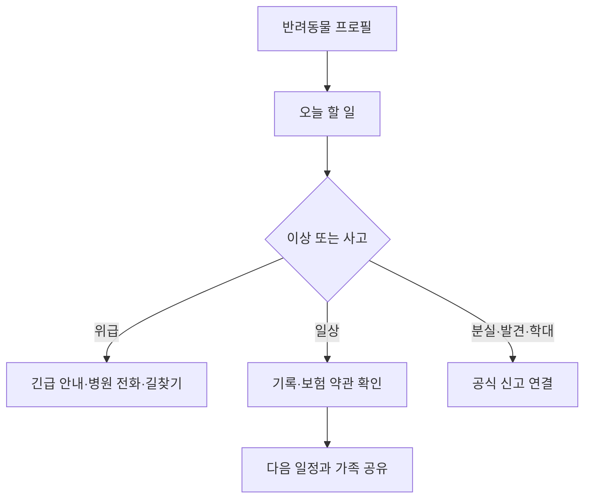
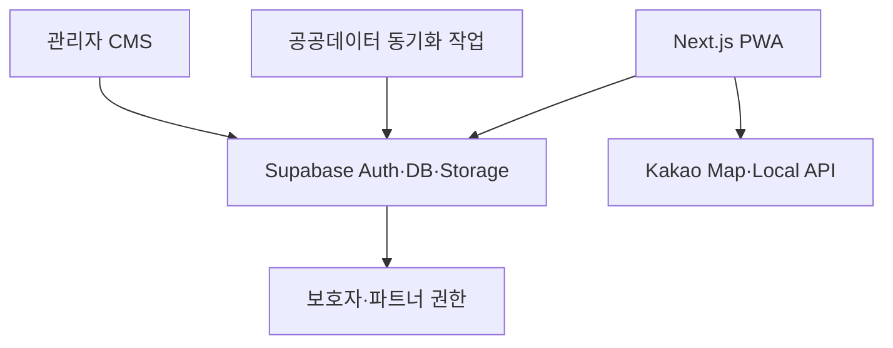

# 펫안심365(PETSAFE 365) 플랫폼 개발 인수인계서

- 문서 버전: 1.0
- 작성 기준일: 2026-08-31
- 우선 시장: 대한민국
- 우선 채널: 모바일 우선 반응형 웹·PWA
- 현재 시연 사이트: <https://pet-safe365.real-osong.chatgpt.site>
- 이 문서의 목적: Claude Code가 기획을 다시 해석하지 않고 실제 작동하는 플랫폼을 구현하게 하는 단일 기준 문서

> 이 문서를 프로젝트 루트의 `PETSAFE365_CLAUDE_HANDOFF.md`에 두고, 함께 제공된 `PETSAFE365_CLAUDE_MASTER_PROMPT.md`를 Claude Code에 붙여 넣는다.

---

## 1. 프로젝트 한 줄 정의

반려견·반려묘 프로필을 한 번 등록하면 보호자가 **오늘 해야 할 일**, **위급할 때 갈 곳**, **주변 동물병원과 동반 장소**, **보험 약관 확인**, **분실·발견·유기·학대 신고**, **인수공통감염병 예방정보**까지 한 흐름에서 이용하는 반려생활 안전 플랫폼이다.

슬로건: **오늘 할 일부터, 위급한 순간까지**

핵심 흐름:



---

## 2. 현재 상태와 목표 상태

### 2.1 현재 상태

현재 ChatGPT Sites에 클릭 가능한 시연본이 배포되어 있다. 다음 기능의 화면과 기본 상호작용이 존재한다.

- 반려견·반려묘 전환
- 오늘의 돌봄 체크리스트
- 해야 할 행동·하지 말아야 할 행동
- 진료 유형별 보험 보장 가능성 안내
- 주변 동물병원·동물약국·보호센터 지도 검색 연결
- 반려동물 동반 카페·공원·놀이터 검색
- 분실·발견·유기·학대·불법진료·소비자분쟁 연락처
- SFTS, 공수병, 개 브루셀라증, 톡소포자충증 안내
- 법무·신뢰센터와 운영문서 안내
- 파트너 Pro 수익모델 소개

현재 시연본은 **제품 방향을 보여주는 프로토타입**이다. 실시간 데이터 동기화, 회원 DB, 영구 저장, 정교한 권한관리, 예약·결제, 관리자 CMS가 완성된 운영 플랫폼은 아니다.

### 2.2 목표 상태

1차 목표는 실제 회원가입·프로필·체크리스트·기록·공식 데이터 지도·신고·콘텐츠 관리가 작동하는 운영형 MVP다. 이후 파트너 검증·문의·비의료 예약·구독 순으로 확장한다.

| 구분 | 현재 시연본 | 1차 운영 MVP | 후속 확장 |
|---|---|---|---|
| 회원 | 로컬 또는 시연 상태 | 실제 인증·세션·탈퇴 | 카카오 로그인·가족 초대 |
| 프로필 | 견/묘 예시 전환 | 여러 마리 등록·수정·삭제 | 가족 공동관리·QR 안심카드 |
| 오늘 할 일 | 예시 카드 | 개체별 생성·완료·반복·기록 | 푸시·캘린더·추천 규칙 |
| 지도 | 지도 검색 연결 | 공공데이터 기반 시설·필터·전화·길찾기 | 업체 검증·문의·예약 |
| 보험 | 일반 안내 | 사용자 약관 메타데이터·항목별 확인 | 문서 OCR·인가 파트너 연계 |
| 신고 | 공식 연락처 연결 | 위치·사진을 포함한 신고 준비 도구 | 관할 자동 연결·처리상태 기록 |
| 감염병 | 4개 질환 안내 | 공식 출처·검수일·행동 기준이 있는 CMS | 지역 위험·알림·다국어 |
| 법무 | 문서 안내 | 실제 약관 게시·동의 버전 기록 | 유료화·파트너 계약 전자화 |
| 수익 | 가격 소개 | 파트너 문의·리드 검증 | 구독·비의료 예약·적법한 제휴 |

---

## 3. 절대 변경하지 말아야 할 제품 원칙

1. **쇼핑몰보다 안전·행동·기록이 먼저다.** 첫 화면에 상품 진열을 두지 않는다.
2. **안전·법정·신고 정보는 무료다.** 유료 벽 뒤로 숨기지 않는다.
3. **의료 진단을 하지 않는다.** 진단명, 약, 용량, 치료 결정을 제시하지 않는다.
4. **보험 가입을 권유하거나 상품 순위를 매기지 않는다.** 약관 이해와 청구 준비 도구로 제한한다.
5. **24시간·응급·전문 진료를 추정하지 않는다.** 검증 여부와 최근 확인일을 표시한다.
6. **카페·공원 등의 동반 가능 여부를 단정하지 않는다.** 방문 전 전화 확인을 기본 행동으로 안내한다.
7. **검색 포털의 리뷰·사진·장소정보를 무단 복제하지 않는다.** 공공데이터, 직접 제공 자료, 적법한 라이선스만 쓴다.
8. **정밀 위치를 기본 저장하지 않는다.** 사용자가 버튼을 눌렀을 때만 브라우저 위치 권한을 요청한다.
9. **신고 대상자의 실명·주소를 공개 게시하지 않는다.** 공식 신고와 증거 보존을 우선한다.
10. **모든 중요한 정보에 출처, 최근 검토일, 검수 상태를 붙인다.**
11. **작동하지 않는 버튼을 만들지 않는다.** 미구현 기능은 숨기거나 `준비 중`으로 명확히 비활성화한다.
12. **기존 저장소가 있으면 파일명·자산 경로·라우트를 임의로 바꾸거나 삭제하지 않는다.** 먼저 조사하고 최소 변경한다.

---

## 4. 핵심 사용자와 역할

| 역할 | 해야 하는 일 | 주요 권한 |
|---|---|---|
| 비회원 | 긴급정보·지도·신고·감염병 정보 확인 | 공개 읽기 |
| 보호자 | 반려동물·일정·건강기록·보험 메모 관리 | 자기 데이터 CRUD |
| 공동 보호자 | 초대받은 반려동물의 일정과 기록 공동관리 | 초대 범위 내 CRUD |
| 파트너 | 업체 정보 검증, 운영시간·서비스·문의 관리 | 자기 업체 데이터 관리 |
| 콘텐츠 검수자 | 건강·감염병·안전 콘텐츠 검토 | 콘텐츠 승인·반려 |
| 관리자 | 데이터 동기화·신고·업체·약관·감사로그 관리 | 전체 운영 권한 |

권한은 프런트 화면 숨김만으로 처리하지 말고 DB Row Level Security 또는 동등한 서버 권한으로 강제한다.

---

## 5. 정보구조와 필수 라우트

### 5.1 공개·보호자 화면

| 라우트 | 화면 | 필수 기능 | 1차 완료 기준 |
|---|---|---|---|
| `/` | 홈 | 긴급 도움, 오늘 할 일, 가까운 곳, 보험, 신고, 감염병 진입 | 모바일에서 핵심 행동이 첫 2스크롤 안에 보임 |
| `/onboarding` | 시작하기 | 반려견/묘, 이름, 생년/추정나이, 성별, 중성화, 체중, 질환·알레르기, 등록·보험 상태 | 중단 후 재개, 필수/선택 구분 |
| `/today` | 오늘 할 일 | 할 일 생성·완료·미루기·메모 | 새로고침 후에도 저장됨 |
| `/pets` | 우리 아이 목록 | 여러 마리 전환·추가 | 사용자별 격리 |
| `/pets/[petId]` | 개체 상세 | 프로필·타임라인·문서·가족 | 삭제 전 재확인·연관 데이터 정책 |
| `/emergency` | 긴급 도움 | 레드플래그, 전화, 길찾기, 중독 정보 기록 | 진단 없이 행동만 안내 |
| `/map` | 주변 시설 | 병원·약국·보호센터·미용·호텔·운송·장례·카페·공원 필터 | 공공데이터 출처·동기화일 표시 |
| `/facilities/[id]` | 시설 상세 | 허가 상태, 연락처, 동반 조건, 검증 배지, 오류 신고 | 광고와 사실정보 분리 |
| `/health` | 건강·예방 | 생활수칙·증상 관찰·진료 준비 | 모든 카드에 출처·검토일 |
| `/health/zoonoses` | 사람과 동물 모두의 건강 | 인수공통감염병 목록·예방 | 질병별 사람/동물 행동 분리 |
| `/health/zoonoses/[slug]` | 질환 상세 | 전파, 예방, 사람 진료 시점, 동물병원 시점, 출처 | 검수 상태 없는 글은 공개 금지 |
| `/insurance` | 보험·비용 | 내 상품 메타정보, 보장·면책 확인, 청구서류 체크 | 최종 지급은 보험사 심사 문구 고정 |
| `/records` | 건강 기록 | 체중·투약 메모·검사·진료·비용·문서 | 개인 파일 비공개 저장 |
| `/reports` | 분실·발견·신고 | 상황 선택, 증거 체크, 공식 신고 연결 | 전화번호·링크·확인일 표시 |
| `/legal` | 법무·신뢰센터 | 약관·개인정보·위치·저작권·환불·광고정책 | 가입 동의 버전과 동일 문서 노출 |

### 5.2 파트너·관리자 화면

| 라우트 | 화면 | 필수 기능 |
|---|---|---|
| `/partner` | 파트너 소개 | Basic·Pro·Growth 설명, 입점 문의 |
| `/partner/apply` | 파트너 신청 | 사업자·업종·허가정보·담당자 동의 |
| `/partner/dashboard` | 업체 운영 | 정보수정, 운영시간, 서비스, 문의 확인 |
| `/admin` | 운영 대시보드 | 콘텐츠·시설·신고·문의·데이터 동기화 현황 |
| `/admin/content` | 콘텐츠 CMS | 초안→검수→승인→게시→만료 흐름 |
| `/admin/facilities` | 시설 검증 | 중복병합, 폐업·휴업, 업체검증, 오류신고 처리 |
| `/admin/legal` | 문서 버전 | 약관 버전·시행일·동의 이력 |
| `/admin/audit` | 감사로그 | 관리자 변경·다운로드·민감정보 접근 기록 |

---

## 6. 대표 사용자 여정과 완료 조건

### 6.1 첫 가입

1. 이메일 매직링크로 가입한다.
2. 반려동물 한 마리를 등록한다.
3. 등록 정보로 기본 오늘 할 일 3개가 생성된다.
4. 홈에 이름과 오늘 할 일이 보인다.
5. 사용자가 완료하면 타임라인에 기록된다.

**완료 조건:** 가입부터 첫 할 일 완료까지 모바일에서 3분 이내, 새로고침·재로그인 후 상태 유지.

### 6.2 위급 상황

1. 홈의 `긴급 도움`을 누른다.
2. 호흡곤란·경련·의식저하·중독 의심 등 관찰 가능한 신호를 고른다.
3. `즉시 동물병원에 전화`와 `가까운 병원 찾기`를 가장 먼저 보여준다.
4. 증상 시작 시간·섭취 물질·사진 등 병원 전달용 메모를 만든다.

**완료 조건:** 진단명·치료법을 제시하지 않으며, 전화와 길찾기가 한 번의 탭으로 실행된다.

### 6.3 주변 병원·카페·공원 찾기

1. 위치 권한 버튼 또는 주소 입력으로 중심 위치를 정한다.
2. 시설 유형과 거리, 현재 데이터 상태로 필터한다.
3. 시설 상세에서 출처, 영업 상태, 최근 동기화, 사업자 확인 여부를 본다.
4. 전화·길찾기·오류신고를 실행한다.

**완료 조건:** `허가상 영업`, `운영시간 확인`, `실제 영업 중`을 서로 다른 필드와 배지로 표시한다.

### 6.4 보험 확인

1. 보험사·상품명·약관 버전·가입일·갱신일·자기부담금·한도를 입력한다.
2. 진료 유형 또는 영수증 항목을 선택한다.
3. 결과를 `보장 가능성 높음`, `약관 확인 필요`, `일반적 제외`로 보여준다.
4. 근거가 되는 사용자 입력 조항 또는 공식 일반안내를 함께 보여준다.

**완료 조건:** 특정 상품 추천·순위·가입 버튼이 없고, 모든 결과에 `최종 지급 여부는 보험사가 약관과 심사를 통해 결정합니다`가 보인다.

### 6.5 인수공통감염병

1. 질환을 선택한다.
2. 동물의 증상·사람의 증상·전파경로·예방을 분리해 읽는다.
3. `사람이 의료기관에 갈 때`와 `반려동물이 동물병원에 갈 때`를 구분한다.
4. 질병관리청·농림축산검역본부 등 공식 원문을 연다.

**완료 조건:** 1차 공개 질환은 SFTS, 공수병, 개 브루셀라증, 톡소포자충증이며, 각 글에 검수자·검토일·출처가 있다.

### 6.6 분실·발견·학대 신고

1. 상황을 선택한다.
2. 사진·발견 시간·위치·특징을 정리한다.
3. 공식 번호와 온라인 신고를 연다.
4. 사용자가 원할 때만 신고 준비 내용을 기기에 저장한다.

**완료 조건:** 개인정보가 공개 게시판에 자동 게시되지 않으며, 공식기관 연결이 우선이다.

---

## 7. 해야 할 것·하지 말아야 할 것 엔진

규칙 엔진은 `종`, `나이`, `중성화`, `체중`, `질환·알레르기`, `실내외 생활`, `다동물 여부`, `동물등록`, `보험`, `보호자 지정 일정`을 입력으로 사용한다.

우선순위:

1. 보호자 또는 담당 수의사가 입력한 일정
2. 법정 의무
3. 안전·응급 관련 일정
4. 생애주기 일반 권고
5. 생활·편의 일정

| 분류 | 해야 할 것 | 하지 말아야 할 것 | 화면 행동 |
|---|---|---|---|
| 법정 의무 | 등록·인식표·안전조치·배설물 수거 확인 | 미등록·무단방치·통제 없는 이동 | 등록기관 찾기·완료 체크 |
| 건강 | 식욕·음수·배변·체중·행동 변화 기록 | 사람 약 임의 투여 | 기록·병원 전화 |
| 중독 | 제품명·성분·양·시간 기록 후 즉시 문의 | 토하게 하거나 민간요법 적용 | 긴급카드·병원 찾기 |
| 외출 | 기온·노면·목줄·물·배변봉투 확인 | 더운 차 안 방치·무리한 운동 | 외출 전 체크 |
| 행동 | 긍정적 강화·스트레스 관찰 | 체벌·공포 유발 | 행동일지·전문가 찾기 |
| 고양이 환경 | 수직공간·숨을 곳·화장실·위험식물 점검 | 끈·실·사람 약·백합류 노출 | 집안 안전점검 |

일반 권고 일정은 하드코딩하지 말고 `care_task_templates`의 버전 데이터로 관리한다. 담당 수의사가 정한 일정이 있으면 일반 템플릿보다 우선한다.

---

## 8. 지도·시설 데이터 설계

### 8.1 시설 유형

`animal_hospital`, `animal_pharmacy`, `shelter`, `grooming`, `boarding`, `funeral`, `transport`, `pet_cafe`, `park`, `playground`, `lodging`, `restaurant`, `shopping`

### 8.2 데이터 출처 우선순위

1. 중앙·지방정부 공공데이터의 인허가·보호센터 정보
2. 한국관광공사 반려동물 동반여행 데이터
3. 사업자가 직접 제출하고 관리자가 확인한 정보
4. 사용자의 오류 신고·최근 전화 확인
5. 지도 사업자의 검색결과는 보조 검색과 길찾기에만 사용

### 8.3 필수 데이터 규칙

- 공공데이터 원본 레코드와 서비스용 정규화 레코드를 분리한다.
- `source_system + source_id`를 중복 방지 키로 사용한다.
- 주소 좌표가 EPSG:5174이면 WGS84로 변환하고 변환 로그를 남긴다.
- 폐업·휴업 정보는 삭제하지 말고 상태와 이력을 유지한다.
- `24시간`, `응급`, `전문 진료`, `반려동물 실내 동반`은 사업자 확인 또는 최근 사용자 전화 확인이 없으면 `미확인`으로 표시한다.
- 카페·공원은 크기 제한, 이동장, 목줄, 실내/실외, 예방접종 증명, 추가요금, 최근 확인일을 별도 필드로 둔다.
- 지도에서 업체 순위 판매를 하지 않는다. 스폰서 노출은 `광고`를 명시하고 자연 검색과 분리한다.

### 8.4 위치 개인정보

- `내 주변 찾기`를 눌렀을 때만 브라우저 위치 권한을 요청한다.
- 기본 검색은 주소·지하철역·행정동 입력으로도 가능해야 한다.
- 정밀 좌표를 사용자 계정에 저장하지 않는다.
- 신고 목적으로 저장해야 할 때는 목적·보유기간·제3자 제공을 별도 동의받고 삭제 기능을 제공한다.

---

## 9. 보험·비용 기능의 경계

### 허용

- 사용자가 가입한 보험의 상품명·가입일·갱신일·한도·자기부담금 기록
- 약관 원문 또는 사용자가 입력한 조항 보관
- 보장·면책 항목을 이해하기 쉽게 정리
- 청구에 필요한 서류 체크리스트
- `약관 확인 필요` 안내와 보험사 고객센터 연결

### 금지 또는 별도 인가·제휴 전 보류

- 사용자에게 특정 보험 가입 권유
- 개인 맞춤 상품 순위
- 보험료 실시간 비교 후 바로 가입
- 가입 성공 수수료 수취
- `무조건 보장` 또는 `100% 지급` 표현

### 고정 문구

> 본 기능은 보험상품 가입 권유나 보험금 지급 결정을 제공하지 않습니다. 실제 보장 여부와 보험금은 가입 당시 약관 및 보험사의 심사에 따라 결정됩니다.

결과는 정확한 이분법이 아니라 다음 세 단계로만 표시한다.

- 보장 가능성 높음
- 약관 확인 필요
- 일반적 제외

각 결과에는 `근거 유형`, `근거 문구/사용자 입력`, `약관 버전`, `판정 시각`을 저장한다.

---

## 10. 건강·인수공통감염병 콘텐츠 모델

모든 콘텐츠는 다음 필드를 가진다.

- 제목, 요약, 대상 종
- 관찰할 동물 신호
- 관찰할 사람 신호
- 전파경로
- 예방 행동
- 사람이 의료기관에 갈 기준
- 동물이 동물병원에 갈 기준
- 하지 말아야 할 행동
- 공식 출처 URL과 기관명
- 작성자, 검수자, 검수자 자격
- 검토일, 다음 검토예정일
- 상태: `draft`, `in_review`, `approved`, `published`, `expired`, `archived`
- 버전과 변경 사유

의료 관련 콘텐츠는 `approved`이고 검토기한이 지나지 않은 버전만 공개한다. 만료 콘텐츠는 자동 비공개하거나 `검토 중`으로 대체한다.

---

## 11. 신고·연락처 설계

연락처를 코드에 흩어놓지 말고 관리자용 `official_contacts` 테이블에서 관리한다.

| 상황 | 기본 연결 | 구현 주의 |
|---|---|---|
| 유실·유기 동물 발견 | 1577-0954·국가동물보호정보시스템 온라인 신고 | 번호와 링크의 최근 확인일 표시 |
| 내 동물 분실 | 국가동물보호정보시스템·동물등록 변경/유실 절차 | 전단용 자료 생성은 2차 |
| 진행 중 학대·생명 위험 | 112·관할 지자체 동물보호 담당 | 신고자 안전을 최우선 안내 |
| 불법 동물진료 의심 | 대한수의사회 신고 채널 | 번호를 하드코딩하지 말고 운영자 검증 후 게시 |
| 서비스·진료비 분쟁 | 업체 이의제기·1372 소비자상담 | 영수증·설명·대화 기록 보존 안내 |

필드: `category`, `organization`, `phone`, `url`, `coverage_area`, `available_hours`, `verified_at`, `valid_from`, `valid_to`, `source_url`, `status`.

---

## 12. 권장 기술구조

버전 번호는 이 문서에 고정하지 않고 구현 시점의 안정 버전을 사용한다.

| 계층 | 권장 구성 | 이유 |
|---|---|---|
| 프런트 | Next.js App Router + TypeScript + Tailwind CSS | SSR·PWA·접근성·유지보수 |
| UI | 접근 가능한 Headless UI 또는 shadcn/ui 계열 | 일관된 키보드·스크린리더 지원 |
| 백엔드 | Supabase Auth + PostgreSQL + Storage + Row Level Security | 저비용 운영 MVP |
| 지도 | Kakao Map SDK/Local API + 공공데이터 | 국내 주소·길찾기 편의 |
| 좌표 | `proj4` 등 검증된 변환 라이브러리 | EPSG:5174→WGS84 변환 |
| 배치 | 서버 Cron 또는 GitHub Actions | 공공데이터 정기 동기화 |
| 알림 | 웹 푸시·이메일은 2차, 먼저 앱 내 알림 | 초기 복잡도 절감 |
| 분석 | 개인정보 최소화 이벤트 분석 | 활성화·재방문·오류율 측정 |
| 테스트 | 단위 + 통합 + Playwright E2E + 접근성 검사 | 핵심 행동 회귀 방지 |



### 12.1 환경변수 예시

실제 키를 저장소에 커밋하지 않는다. `.env.example`만 제공한다.

```dotenv
NEXT_PUBLIC_APP_URL=
NEXT_PUBLIC_SUPABASE_URL=
NEXT_PUBLIC_SUPABASE_ANON_KEY=
SUPABASE_SERVICE_ROLE_KEY=
NEXT_PUBLIC_KAKAO_MAP_APP_KEY=
KAKAO_REST_API_KEY=
PUBLIC_DATA_SERVICE_KEY=
TOUR_API_SERVICE_KEY=
CRON_SECRET=
ADMIN_BOOTSTRAP_EMAIL=
SENTRY_DSN=
```

서버 전용 키에 `NEXT_PUBLIC_` 접두사를 붙이지 않는다.

---

## 13. 최소 데이터 모델

모든 테이블은 `id`, `created_at`, `updated_at`을 기본으로 갖는다. 삭제가 감사·법적 이력에 영향을 주는 데이터는 `deleted_at` 소프트 삭제를 사용한다.

### 13.1 사용자·반려동물

| 테이블 | 핵심 필드 |
|---|---|
| `profiles` | `user_id`, `display_name`, `locale`, `role`, `marketing_consent_at` |
| `pets` | `owner_id`, `species`, `name`, `birth_date`, `estimated_birth`, `sex`, `neutered`, `weight_kg`, `registration_status`, `insurance_status` |
| `pet_guardians` | `pet_id`, `user_id`, `guardian_role`, `permission`, `invited_at`, `accepted_at` |
| `pet_conditions` | `pet_id`, `type`, `name`, `note`, `active`, `source` |

### 13.2 일정·기록·문서

| 테이블 | 핵심 필드 |
|---|---|
| `care_task_templates` | `species`, `life_stage`, `category`, `title`, `rule_json`, `version`, `source_id`, `reviewed_at`, `status` |
| `care_tasks` | `pet_id`, `template_id`, `title`, `due_at`, `repeat_rule`, `priority`, `status`, `completed_at`, `created_by` |
| `health_events` | `pet_id`, `event_type`, `occurred_at`, `value_json`, `note`, `visibility` |
| `documents` | `pet_id`, `owner_id`, `document_type`, `storage_path`, `original_name`, `mime_type`, `size`, `retention_until` |

### 13.3 보험

| 테이블 | 핵심 필드 |
|---|---|
| `insurance_policies` | `pet_id`, `insurer`, `product_name`, `terms_version`, `joined_at`, `renewal_at`, `coverage_json`, `deductible_json`, `user_confirmed_at` |
| `insurance_terms` | `policy_id`, `category`, `clause_text`, `clause_reference`, `classification`, `source_document_id` |
| `insurance_checks` | `policy_id`, `input_json`, `result`, `evidence_json`, `checked_at` |

### 13.4 지도·파트너

| 테이블 | 핵심 필드 |
|---|---|
| `facilities` | `facility_type`, `name`, `address`, `lat`, `lng`, `phone`, `business_status`, `source_system`, `source_id`, `source_updated_at` |
| `facility_details` | `facility_id`, `hours_json`, `services_json`, `pet_access_json`, `emergency_status`, `specialty_status` |
| `facility_verifications` | `facility_id`, `verification_type`, `verified_by`, `verified_at`, `expires_at`, `evidence`, `status` |
| `facility_reports` | `facility_id`, `reporter_id`, `report_type`, `details`, `status`, `resolved_at` |
| `partners` | `facility_id`, `owner_user_id`, `plan`, `business_number_masked`, `verification_status` |
| `partner_inquiries` | `partner_id`, `user_id`, `pet_id`, `category`, `message`, `status`, `consent_at` |

### 13.5 콘텐츠·신고·법무

| 테이블 | 핵심 필드 |
|---|---|
| `content_cards` | `slug`, `content_type`, `species`, `current_version_id`, `status` |
| `content_versions` | `content_id`, `version`, `body_json`, `source_json`, `author_id`, `reviewer_id`, `reviewed_at`, `expires_at`, `change_reason` |
| `official_contacts` | `category`, `organization`, `phone`, `url`, `coverage_area`, `verified_at`, `source_url`, `status` |
| `incident_drafts` | `user_id`, `incident_type`, `occurred_at`, `location_precision`, `details_json`, `retention_until` |
| `legal_documents` | `document_type`, `version`, `effective_at`, `body`, `status` |
| `user_consents` | `user_id`, `document_type`, `document_version`, `consented_at`, `ip_hash` |
| `audit_logs` | `actor_id`, `action`, `entity_type`, `entity_id`, `metadata_json`, `created_at` |

### 13.6 보안 기본값

- 보호자는 자기 데이터만 읽고 쓴다.
- 공동 보호자는 초대된 `pet_id`만 권한 범위 내에서 접근한다.
- 파트너는 자기 업체와 문의만 접근한다.
- 검수자는 콘텐츠 승인 이력만 변경한다.
- 관리자 접근과 민감정보 다운로드는 감사로그를 남긴다.
- 문서 버킷은 비공개이며 짧은 만료시간의 서명 URL로만 접근한다.
- 파일 업로드 시 MIME·크기·확장자 검증, 악성파일 검사 연결 지점을 둔다.

---

## 14. 데이터/API 연동 후보

| 용도 | 출처 | 연동 방식 | 주의 |
|---|---|---|---|
| 지도 표시·주소/좌표 | Kakao Map SDK·Local REST API | 클라이언트 지도 + 서버 프록시 | 키 노출 범위·쿼터·도메인 제한 |
| 전국 동물병원 | 행정안전부 동물_동물병원 조회서비스 | 일 배치 수집 | EPSG:5174 변환, 폐업상태 |
| 동물약국·미용·위탁·장묘·운송 | 공공데이터포털 전국 인허가 데이터 | 일/주 배치 | 데이터셋별 필드 정규화 |
| 보호센터 | 국가동물보호정보시스템 동물보호센터 API | 일 배치 | 전화·운영시간 누락 가능 |
| 동반 여행지 | 한국관광공사 반려동물 동반여행 서비스 | 일/주 배치 | 동반 조건·사진 라이선스·수정일 |
| 신고 | 국가동물보호정보시스템·관할기관 | 공식 링크·전화 | 자동 제출은 별도 협약 전 금지 |
| 감염병 | 질병관리청·농림축산검역본부 | 관리자 CMS·정기 검토 | 원문 링크·검수일 필수 |

개발 참고 링크:

- Kakao Map 개요: <https://developers.kakao.com/docs/ko/kakaomap/common>
- Kakao Local REST API: <https://developers.kakao.com/docs/ko/local/dev-guide>
- 전국 동물병원 조회서비스: <https://www.data.go.kr/data/15154952/openapi.do?recommendDataYn=Y>
- 공공데이터포털: <https://www.data.go.kr>
- 국가동물보호정보시스템: <https://www.animal.go.kr>
- 한국관광공사 TourAPI: <https://api.visitkorea.or.kr>
- 질병관리청 감염병포털: <https://dportal.kdca.go.kr>

API 명칭·정책·쿼터는 바뀔 수 있으므로 개발 시작일에 공식 문서에서 재확인하고 `docs/data-sources.md`에 확인일을 기록한다.

---

## 15. 디자인 시스템

### 15.1 인상

- 귀엽기만 한 쇼핑몰이 아니라 **차분하고 친절한 안전 서비스**
- 병원처럼 차갑지 않고, 장난감 앱처럼 가볍지 않게
- 초보 보호자도 한 번 읽고 행동할 수 있는 쉬운 한국어

### 15.2 권장 토큰

| 용도 | 값 |
|---|---|
| 배경 | `#F8F7F2` |
| 기본 카드 | `#FFFFFF` |
| 주색 | `#0F766E` |
| 보조색 | `#2563EB` |
| 긴급 | `#C2413B` |
| 주의 | `#D97706` |
| 본문 | `#1F2937` |
| 보조본문 | `#64748B` |
| 테두리 | `#E2E8F0` |

- 본문 기본 16px 이상
- 주요 버튼 높이 48px 이상
- 둥근 모서리 14~18px
- 긴급 버튼은 색뿐 아니라 아이콘·문구로 구분
- Pretendard 또는 시스템 한글 폰트 스택 사용
- 모바일 하단탭: `오늘 | 우리 아이 | 지도 | 기록 | 더보기`
- 데스크톱에서는 좌측 또는 상단 내비게이션으로 전환
- 모든 폼에 라벨·오류문구·키보드 포커스 제공

### 15.3 홈 우선순위

1. 반려동물 전환·알림
2. 긴급 도움
3. 오늘의 할 일 3개
4. 가까운 병원·약국·동반 장소
5. 보험·비용
6. 분실·발견·학대 신고
7. 이번 주 건강·인수공통감염병

---

## 16. 법무·저작권·운영 통제

아래 문서는 법률자문 완결본이 아니라 운영 초안이다. 사업자 정보, 결제 구조, 실제 데이터 흐름을 확정한 뒤 유료 공개 전 변호사·세무사·보험/위치정보 전문가 검토가 필요하다.

### 16.1 출시 전에 게시·준비할 문서

- 서비스 이용약관
- 개인정보 처리방침·가입 동의
- 위치기반서비스 이용약관 또는 실제 처리구조에 맞춘 위치정보 안내
- 구독·결제·청약철회·환불 정책과 신청서
- 저작권·이용자 게시물 운영정책과 침해 신고서
- 파트너 입점·광고 계약서와 검증표
- 공공데이터·사진·아이콘·폰트 라이선스 관리대장
- 개인정보 사고 대응 절차
- 콘텐츠 검수·정정·회수 절차
- 광고·협찬·추천 표시 정책

### 16.2 개발 통제

- 가입·약관 동의는 문서 버전을 저장한다.
- 선택 동의는 필수 동의와 분리한다.
- 탈퇴·데이터 다운로드·삭제 요청 경로를 제공한다.
- 건강문서·보험문서·위치·신고정보는 광고 타기팅에 사용하지 않는다.
- 주민등록번호와 사람의 진단정보는 수집하지 않는다.
- 사진·후기 업로드 전 권리보유·초상권·개인정보 비노출 확인을 받는다.
- 검색 포털 사진·리뷰를 크롤링하거나 복사하지 않는다.
- 공공데이터·관광사진은 레코드별 라이선스와 출처를 기록한다.
- 파트너·후원·광고는 콘텐츠 가까이에 `광고` 또는 `유료 제휴`를 표시한다.
- 결제는 사업자정보·통신판매업·환불 흐름이 완성될 때까지 기능 플래그로 잠근다.

### 16.3 기능 플래그

```ts
type LegalFeatureFlags = {
  paymentsEnabled: boolean;
  partnerSubscriptionsEnabled: boolean;
  insuranceReferralEnabled: boolean;
  preciseLocationStorageEnabled: boolean;
  publicReviewsEnabled: boolean;
};
```

초기 운영 기본값은 모두 `false`다. 검토 없이 코드 배포만으로 켜지지 않게 관리자 승인과 감사로그를 둔다.

---

## 17. 수익모델과 개발 순서

| 상품 | 가격 가정 | 제공 기능 | 1차 처리 |
|---|---:|---|---|
| 보호자 무료 | 0원 | 1마리, 오늘 체크, 지도·신고, 기본 기록, 보험 교육 | 구현 |
| 보호자 Plus | 월 4,900원 / 연 49,000원 | 여러 마리, 가족공유, 무제한 기록, QR 카드, 문서 정리 | 화면·권한 설계, 결제 보류 |
| 파트너 Basic | 0원 | 공공데이터 기반 프로필·수정 요청 | 구현 |
| 파트너 Pro | 월 59,000원 | 인증배지, 서비스·운영시간, 문의, 후기응답, 통계 | 파일럿 문의까지 구현 |
| 파트너 Growth | 월 149,000원 | CRM·쿠폰·다지점·상세분석 | 2차 |
| 비의료 예약 | 거래액 8~12% 가정 | 미용·호텔·돌봄·운송·훈련 | 2차, 의료비 수수료 제외 |

첫 수익 검증은 보호자 결제보다 **지역 파트너 30곳의 검증 프로필·문의 리드**로 한다.

---

## 18. 단계별 구현 계획

### Phase 0 — 저장소 조사·기반 정리

- [ ] 기존 코드·라우트·자산·의존성·환경변수 조사
- [ ] 현재 작동 기능 목록과 깨진 기능 목록 작성
- [ ] 기존 파일 삭제·대규모 재구성 없이 기술부채 기록
- [ ] `.env.example`, `README.md`, `docs/decisions.md` 준비
- [ ] 로컬 개발·빌드·테스트 명령 확인

### Phase 1 — 실제 저장되는 보호자 MVP

- [ ] Supabase 스키마·마이그레이션·RLS
- [ ] 이메일 매직링크 인증·로그아웃·탈퇴
- [ ] 반려동물 CRUD와 여러 마리 전환
- [ ] 오늘 할 일 생성·완료·미루기·기록
- [ ] 건강 타임라인과 비공개 문서 업로드
- [ ] 긴급 도움·전화·병원 찾기
- [ ] 공식 연락처 기반 신고 허브
- [ ] 인수공통감염병 CMS와 4개 초기 글
- [ ] 약관·개인정보·위치·저작권 페이지
- [ ] 관리자 최소 CMS

**Phase 1 통과 기준:** 인증·저장·권한이 실제 DB에서 작동하고, 다른 사용자 데이터 접근 테스트가 실패해야 한다.

### Phase 2 — 공공데이터 지도·보험 도구

- [ ] Kakao 지도·주소 검색·선택형 위치 권한
- [ ] 동물병원·약국·보호센터·생활업·동반여행 데이터 수집기
- [ ] 좌표변환·중복병합·폐업이력·동기화 로그
- [ ] 카페·공원 동반조건·최근 확인일
- [ ] 시설 오류 신고·파트너 정보수정 신청
- [ ] 보험 상품 메타정보·약관 항목·3단계 확인 결과
- [ ] 출처·검수일·데이터 상태 배지

### Phase 3 — 파일럿과 B2B

- [ ] 수도권 2~3개 생활권 파트너 30곳
- [ ] 파트너 신청·관리자 승인·업체 대시보드
- [ ] 보호자→파트너 문의와 동의 기록
- [ ] 리드·응답·정보오류 운영 지표
- [ ] Plus·Pro 권한 플래그
- [ ] 사업자·법무 검토 완료 후 결제 어댑터 연결

### Phase 4 — 확장

- [ ] 가족 초대·세분 권한
- [ ] QR 안심카드
- [ ] 알림·캘린더
- [ ] 비의료 예약
- [ ] 다국어
- [ ] 약관 OCR과 검수 흐름

### MVP에서 만들지 않을 것

- 자체 물류·재고·당일배송
- AI 확정진단·처방·약 배송
- 무검증 공개 폭로형 학대 게시판
- 인가 없는 맞춤 보험 추천·모집
- 의료비 연동 수수료
- 보상 없는 산책 포인트·대규모 커뮤니티

---

## 19. 테스트와 완료 정의

### 19.1 자동 테스트

- 단위: 규칙 엔진, 보험 3단계 분류, 좌표변환, 연락처 유효기간
- 통합: 인증, RLS, 파일 접근, 데이터 동기화 upsert, 콘텐츠 승인
- E2E: 가입→반려동물 등록→할 일 완료→기록 확인
- E2E: 위치 거부 상태에서도 주소 검색으로 지도 사용
- E2E: 긴급 전화·길찾기 링크 생성
- E2E: 다른 사용자의 `pet_id` 직접 접근 차단
- 접근성: 키보드, 포커스, 색 대비, 폼 라벨, 스크린리더 이름

### 19.2 수동 점검

- 모바일 360px, 390px, 태블릿, 데스크톱
- Chrome, Safari, Edge 최신 안정판
- 느린 네트워크·API 실패·위치 거부·데이터 없음 상태
- 긴 한국어 이름·주소·문서명 줄바꿈
- 전화번호·외부링크·다운로드가 실제 작동하는지 확인

### 19.3 Definition of Done

기능은 아래 조건을 모두 만족해야 완료다.

1. UI만 존재하지 않고 실제 데이터 흐름이 작동한다.
2. 로딩·빈 상태·오류·권한 거부 상태가 있다.
3. 모바일과 키보드 접근이 가능하다.
4. 권한·입력값·파일을 서버에서도 검증한다.
5. 테스트가 있으며 전체 빌드가 통과한다.
6. 출처·검토일·광고·미확인 상태를 숨기지 않는다.
7. `README.md`에 실행법과 필요한 키가 기록돼 있다.
8. 미완료 기능은 완료로 보고하지 않는다.

---

## 20. 운영 지표

| 단계 | 지표 | 초기 목표 |
|---|---|---:|
| 활성화 | 가입 24시간 내 프로필 완성 | 60% 이상 |
| 가치 경험 | 첫 주 오늘 할 일 3회 이상 완료 | 35% 이상 |
| 재방문 | 4주차 주간 활성 유지 | 25% 이상 |
| 데이터 품질 | 오류 신고 처리 | 48시간 이내 |
| B2C | 무료→Plus | 3~6% |
| B2B | 파트너 무료→Pro | 10~20% |
| 거래 | 문의→예약·방문 | 20% 이상 |

분석 이벤트에는 건강문서 내용, 정밀 위치, 신고 내용, 보험 약관 원문을 넣지 않는다.

---

## 21. Claude가 만들어야 할 산출물

- 실행 가능한 전체 소스코드
- `README.md`: 설치·환경변수·개발·테스트·배포
- `.env.example`: 비밀값 없는 키 목록
- `supabase/migrations/*`: 스키마·인덱스·RLS·초기 관리자 정책
- `scripts/import-*`: 공공데이터 수집·정규화·upsert
- `docs/data-sources.md`: 데이터셋·라이선스·필드·갱신주기·확인일
- `docs/legal-readiness.md`: 기능 플래그와 출시 전 확인사항
- `docs/content-review.md`: 건강·감염병 콘텐츠 검수 흐름
- 테스트 코드와 실행 결과
- 시드 데이터: 모두 `예시 데이터`로 표시하고 실제 업체처럼 보이지 않게 구성
- 구현 완료·미완료·키 필요·법률검토 필요 항목을 구분한 최종 보고

---

## 22. 클로드 작업 규칙

1. 작업 전에 이 파일 전체와 저장소를 읽는다.
2. 기존 변경사항은 사용자 소유로 보고 함부로 되돌리지 않는다.
3. 이미지·문서·오디오·라우트 경로를 임의로 바꾸지 않는다.
4. 삭제나 대규모 구조변경이 필요하면 이유·대상·영향을 먼저 기록하고 최소 변경안을 택한다.
5. API 키가 없어도 구조·어댑터·에러상태·시드 명령까지 구현한다.
6. 키가 없다는 이유로 전체를 정적 가짜 데이터로 끝내지 않는다.
7. 시연 데이터와 실제 데이터는 화면과 DB에서 구분한다.
8. 사용자가 코드를 직접 수정하게 하지 말고 Claude가 파일을 수정·실행·검증한다.
9. 한 단계가 끝날 때마다 빌드와 관련 테스트를 실행하고 실패를 고친다.
10. `완료`라는 말은 Definition of Done을 통과한 기능에만 사용한다.

---

## 23. 사업자가 나중에 제공해야 할 값

이 값이 없어도 Claude는 코드 구조를 만들 수 있지만, 실제 공개·결제·발송 전에 확정해야 한다.

- 사업자명·대표자·사업자등록번호·주소
- 고객센터 이메일·전화·운영시간
- 개인정보 보호책임자
- 국내외 데이터 저장·처리업체
- 통신판매업 신고정보
- 결제대행사 계정
- Kakao 앱 키와 허용 도메인
- 공공데이터포털·TourAPI 키
- 운영자·콘텐츠 검수자 계정
- 수의사·법률·보험 검수 체계
- 서비스명 상표·도메인 확인 결과

---

## 24. 공식 근거·운영 참고 링크

- 농림축산식품부 유실·유기 동물 신고 안내: <https://www.mafra.go.kr/home/5109/subview.do?enc=Zm5jdDF8QEB8JTJGYmJzJTJGaG9tZSUyRjc5MiUyRjU3NzMxNyUyRmFydGNsVmlldy5kbyUzRg%3D%3D>
- 찾기쉬운 생활법령정보 반려동물: <https://easylaw.go.kr/CSP/CnpClsMain.laf?ccfNo=2&cciNo=2&cnpClsNo=1&csmSeq=1809&popMenu=ov>
- 질병관리청 인수공통감염병 정보: <https://dportal.kdca.go.kr/pot/ii/sttyInftnsds/sttyInftnsds.do>
- 정부24 통신판매업 신고: <https://www.gov.kr/mw/AA020InfoCappView.do?CappBizCD=11300000006&HighCtgCD=A09006>
- 개인정보보호위원회: <https://www.pipc.go.kr>
- 금융위원회 보험 비교·추천 안내: <https://www.fsc.go.kr/edu/news/84340>
- 공정거래위원회 광고·추천 표시: <https://www.ftc.go.kr>
- 한국저작권위원회: <https://www.copyright.or.kr>
- 공공데이터포털: <https://www.data.go.kr>
- Kakao Developers: <https://developers.kakao.com>

> 법령, 보험 약관, 신고 연락처, API 정책·쿼터, 시설 운영시간은 바뀔 수 있다. 운영 화면에는 `최근 확인일`과 공식 원문 링크를 함께 표시한다.

---

## 25. 최종 인수인계 결론

펫안심365의 경쟁력은 기능의 수가 아니라 **상황→판단 보조→행동→기록**을 한 흐름으로 연결하고, 각 정보의 출처와 검증 상태를 숨기지 않는 데 있다. Claude는 먼저 Phase 0과 Phase 1을 실제 데이터가 저장되는 상태로 완성하고, 그다음 공공데이터 지도와 보험 약관 도구를 붙인다. 결제·보험모집·정밀 위치 저장·공개 후기처럼 법적 위험이 커지는 기능은 기능 플래그를 기본적으로 잠근 채 별도 승인을 거친다.
